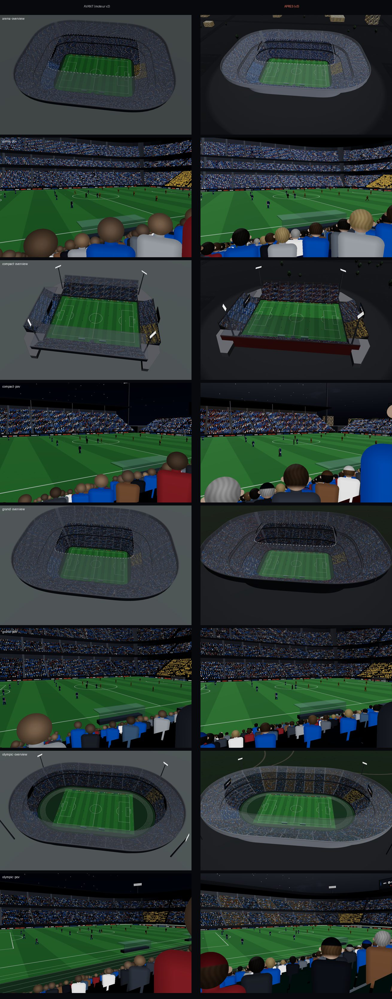

# Audit V3 — Expérience, réalisme, intelligence, présentation

Périmètre : trois briefs appliqués ensemble à Vantage v2 — *UX 3.0 (Experience, Realism & Intelligence Overhaul)*, *UI/UX System v1.0*, *Presentation Ready Master Pass* — dans l'ordre imposé par le dernier (VenueConfig → archétypes → environnement → sélecteurs → présentation → scénarios → réinitialisation → révélation → performance → hors ligne → constructions → régression).

> Incident de départ : l'espace de travail de la phase précédente a été perdu (seuls README et index.html survivaient). Les sources v2 ont été **reconstruites** à l'identique du dernier état testé (20/20), puis mesurées avant toute modification. La « mesure de départ » porte donc sur ce moteur v2 reconstruit ; l'ancienne interface v2 n'a pas été reconstruite (remplacée intégralement par UI v1.0) et n'est pas comparée en captures.

## 1. Mesure de départ (moteur v2, 1280 × 800, GPU logiciel)

| Lieu v2 | Places | Appels (ensemble) | Triangles (ensemble) | Géométries | Appels (vue siège) |
|---|---|---|---|---|---|
| A bol 3 niveaux | 54 652 | 87 | 597 173 | 53 | 63 |
| B compact | 23 112 | 47 | 160 392 | 52 | 95 |
| C grand stade | 79 348 | 87 | 818 536 | 101 | 69 |
| D piste | 42 441 | 38 | 58 609 | 104 | 80 |

Captures : `docs/baseline/*_overview.png`, `*_pov.png` (non versionnées, voir `docs/before_after.jpg`).

## 2. Constats (avant)

### UX
1. Ouverture sur une vue statique ; pas d'indication ; tout le panneau de réglages visible d'emblée (aspect « tableau de bord »).
2. Aucune machine d'états d'expérience : modes gérés par booléens (vue siège, comparaison, déplacement) ; retours incohérents.
3. Cadrage indifférent à l'interface : la place sélectionnée pouvait se trouver sous la carte (bureau) ou la feuille (mobile).
4. Transitions de place jusqu'à 2,8 s (recul) et 2,6 s (approche) : trop longues pour un geste répété.
5. Mobile : réutilisation du gabarit bureau, cibles < 44 px, pas de paysage dédié.
6. Comparaison : métriques côte à côte, sans conclusion ; pas de suggestion de place B.

### Rendu et réalisme
7. Un seul « style » de stade : mêmes bétons, mêmes toits ; abords inexistants (sol gris uniforme) ; deux plans coplanaires sous le stade (moiré en rayons).
8. Gradins à contremarche constante : **67 % des places** du bol A sous 60 mm de valeur C (irréaliste pour un stade moderne).
9. Pluie : lignes d'un pixel, invisibles, tombant aussi sous les toits ; aucune humidité ; ciel sans nuages.
10. Nuit : pas de halo ni de faisceau ; abords éclairés comme l'intérieur.
11. Foule vue de dos : têtes en disques bruns uniformes.
12. Écrans géants placés sous le toit, devant les places des derniers rangs (masque la vue).

### Accessibilité
13. Pas de parcours 2D ; pas d'annonce de place ; focus peu visible ; pas de mode confort ; contraste élevé absent.

### Algorithmes
14. « Mieux à proximité » par seuils simples, pouvant proposer une place dominée.
15. Picking au point le plus proche, sans intention (vendue/libre, continuité de rang).
16. Pas de planification de trajectoire : seule l'orbite évitait les gradins.

### Présentation
17. Un seul stade démontrable à la fois en pratique ; pas de mode présentation, de scénarios, de réinitialisation, de liens de scénario ; une seule construction (Lab visible pour tous).

## 3. Changements priorisés (réalisés)

| Priorité | Changement | Brief |
|---|---|---|
| P0 | VenueConfig déclaratif + 5 archétypes distincts (géométrie, styles, toits, abords) | Présentation §2–5, 64–66 |
| P0 | Gradinage à valeur C (`cTarget`), pente ≤ 37° | UX §24–28 (réalisme) |
| P0 | EnvironmentEngine : soleil réel, préréglages calculés, nuages, pluie à carte d'abri, humidité, brume, vent, projecteurs auto, interpolation 3–6 s, conservé entre stades | Présentation §8–29, 68–70 |
| P0 | ModeMachine (9 modes), UI v1.0 (jetons, HUD, dock contextuel, carte, feuille à crans, déplacer, comparer, étiquettes contextuelles), gabarits bureau / mobile / paysage / tablette | UI v1.0 |
| P0 | ViewportInsets → décalage du centre optique + cadrage d'ensemble sur la zone libre | UI v1.0 « Smart viewport » |
| P0 | Mode présentation, scénarios 01–07, réinitialisation, raccourcis, vitrine, enregistrement, capture propre, liens profonds | Présentation §35–46, 91–92 |
| P0 | Trois constructions + contrôle de séparation automatique | Présentation §105 |
| P1 | Transitions aux durées du brief (350–1100 ms), planification sans collision, champ élargi en trajet, lancer du regard avec inertie, zoom ×3 | UI v1.0, UX §13–21 |
| P1 | Picking par classement d'intention, tolérance tactile 18–22 px | UI v1.0 « Selection », UX §12 |
| P1 | Qualité par intention (7 profils), recommandations sur front de Pareto, « Mieux à proximité » non dominé, comparaison en différences + verdict, préférences de session | UX §62–70 |
| P1 | Directeur d'événements : moments de match, but complet, clameur **en cascade** depuis le but, ola, chants, tableau et LED | UX §36–38, Présentation §31–32 |
| P1 | Révélation sur ancres sémantiques (tout stade, toute météo), 8–12 s, HUD masqué sauf « Passer », fin en vue siège | UI v1.0, Présentation §76–79 |
| P1 | Accessibilité : clavier complet, annonces, parcours 2D (+ repli sans WebGL), confort, contraste, texte 200 %, 44 px | UX §71–83, UI v1.0 |
| P1 | Robustesse : perte de contexte, erreurs sans trace, RecoveryController, drapeaux de fonctionnalités | Présentation §51–54, 103, 106 |
| P2 | Abords procéduraux (parvis, routes, parkings, parcs, arbres, immeubles éclairés la nuit) | Présentation §64 |
| P2 | Foule : têtes de dos (cheveux, nuque, oreilles), casquettes, ponchos et capuches des places exposées | UX §37, Présentation §21 |
| P2 | Halos et faisceaux de projecteurs, halo lumineux sur nuages bas | UX §43 |
| P2 | Préchargement des autres stades en temps libre (changements quasi immédiats) | Présentation §49 |
| P2 | Lab à onglets (Scène, Caméra, Places, Révélation, Performance, Accessibilité), états déterministes, simulations d'écran, test mémoire, simulation daltonisme, journal, build | UI v1.0 « Lab », Présentation §107 |

### Non réalisé (assumé)

- Occlusion ambiante, ombres de contact, TAA : coût élevé, gain faible à l'échelle d'un stade ; à reconsidérer sur cible GPU réelle.
- Son spatialisé par tribune, éclairs, neige, commande depuis un téléphone (briefs : « plus tard »).
- Service Worker : inutile — chaque construction est un fichier unique sans dépendance réseau (ouvrable en `file://`, où un Service Worker ne s'enregistre de toute façon pas).
- Analytique distante : remplacée par un journal local sans donnée personnelle (Lab).

## 4. Avant / après

Mêmes stades, même heure (21 h), même place (tribune principale, niveau 1, troisième section, mi-hauteur), 1280 × 800.

| Stade | Places avant → après | Appels (ensemble) | Triangles (ensemble) | Appels (vue siège) | Triangles (vue siège) |
|---|---|---|---|---|---|
| Arena (A) | 54 652 → 56 444 | 87 → 77 | 597 k → 529 k | 63 → 52 | 594 k → 526 k |
| Compact (B) | 23 112 → 23 112 | 47 → 82 | 160 k → 190 k | 95 → 55 | 198 k → 177 k |
| Grand (C) | 79 348 → 83 788 | 87 → 75 | 819 k → 692 k | 69 → 50 | 660 k → 689 k |
| Olympic (D) | 42 441 → 66 116 | 38 → 84 | 59 k → 534 k | 80 → 60 | 351 k → 530 k |

Lecture : malgré les abords (parvis, arbres, immeubles), le ciel nuageux, les halos et la pluie, le coût reste du même ordre ; l'augmentation sur Compact et Olympic vient des abords visibles et, pour Olympic, d'un stade 56 % plus grand (archétype 55–70 k exigé). Les appels baissent en vue siège (moins d'objets annexes dans le champ).

Valeur C (part des places sous 60 mm) :

| Stade | Avant (contremarche constante) | Après (gradinage à valeur C) |
|---|---|---|
| Arena | 67 % | 31 % (niveau 1 : 9 %) |
| Compact | 42 % | 13 % |
| Grand | 73 % | 51 % (niveau 1 : 14 %) |
| Classic (nouveau, gradinage ancien volontaire) | — | 28 % |
| Olympic | 1 % | 0 % |

Visuel : fond gris uniforme → abords lisibles ; têtes en disques → chevelures, nuques, casquettes, ponchos ; pluie invisible → pluie lisible qui épargne les places abritées ; nuit plate → halos, faisceaux, abords sombres, immeubles éclairés ; écrans géants qui masquaient des places → posés sur le bord du toit.

## 5. Résultats des tests

Tous exécutés sur les fichiers construits, Chromium + GPU logiciel (voir `tests/README.md`).

| Suite | Résultat | Commentaire |
|---|---|---|
| Séparation des constructions | ✓ | aucune chaîne de Lab ou de présentateur dans `vantage.html`, aucune chaîne de Lab dans la version présentation |
| Parcours §111 (présentation, une session, sans rechargement) | **24/24** | ouverture → rotation → tribune → section → place au clic → vue siège → joueurs → 3 places → rangs → comparaison qui conclut → bascule A/B → vue d'ensemble → Grand → nuit → pluie → place couverte → place exposée → but → Olympic (pluie conservée) → place à 138 m → vue d'ensemble → révélation finie dans la place → contrôle immédiat → zéro erreur |
| 12 écrans canoniques + paysage + tablette | 19 captures | bureau, mobile 390 × 844, paysage 844 × 390, tablette 1024 × 1366 |
| Matrice 5 stades × 5 ambiances | 25 captures lisibles | jour, coucher, nuit, pluie de jour, nuit + pluie |
| QA vue siège | 5/5 | soleil direct, ombre du toit, projecteurs, pluie exposée, pluie abritée |
| Captures de présentation | 9 | sans interface (mode capture) |
| Accessibilité | **22/22** | axe-core : 0 violation sur 6 états ; clavier seul ; annonce ; Échap ; B ; mouvement réduit ; texte 200 % ; cibles 44 px ; paysage ; repli sans WebGL |
| Performance | 50 états mesurés | volumes exacts, temps relatifs (`docs/PERFORMANCE.md`) |
| Mémoire | stable | 11 changements de stade : géométries 61 → 61, textures 9 → 9 (après correction de 3 fuites) |

### Défauts trouvés par les tests et corrigés

| Défaut | Trouvé par | Correction |
|---|---|---|
| Pluie invisible (traînées éliminées par le « back-face culling ») | QA visuelle | matériau double face |
| Rayons moirés sous le stade | QA visuelle | suppression d'un plan coplanaire (z-fighting) |
| Écran géant masquant le ciel et le terrain depuis le niveau haut olympique | QA vue siège | écrans posés sur le bord du toit |
| Toit opaque après un changement de stade | matrice | état « toit transparent » réinitialisé à chaque chargement |
| Vue d'ensemble portrait rognée | captures mobiles | cadrage sur la zone libre, champ latéral élargi |
| Centre optique décalé en vue siège quand le HUD s'estompe | captures | décalage d'encarts ignoré en vision humaine |
| Mode présentation bloqué au démarrage | §111 | rendu protégé tant qu'aucun stade n'est chargé |
| Vitrine automatique déclenchée pendant une démonstration | §111 | vitrine réservée au mode borne |
| Projecteurs et humidité en retard sur machine lente | §111 | ambiance pilotée par l'horloge murale |
| Focus clavier des panneaux en retard d'une image | a11y | focus synchrone |
| Coupe « mouvement réduit » appliquée une image trop tard | a11y | coupe appliquée immédiatement |
| Poignée de la feuille mobile 22 px de haut | a11y | zone de 44 px |
| 3 fuites mémoire GPU | test mémoire | voir `docs/PERFORMANCE.md` |
| Diagnostics figés sur machine lente | perf | horloge murale |

### Limites de la validation

GPU logiciel uniquement : aucune mesure de fluidité réelle ; pas de Safari iOS ni d'Android réels ; pas de lecteur d'écran réel. Ce sont les trois validations à faire avant une démonstration publique.
